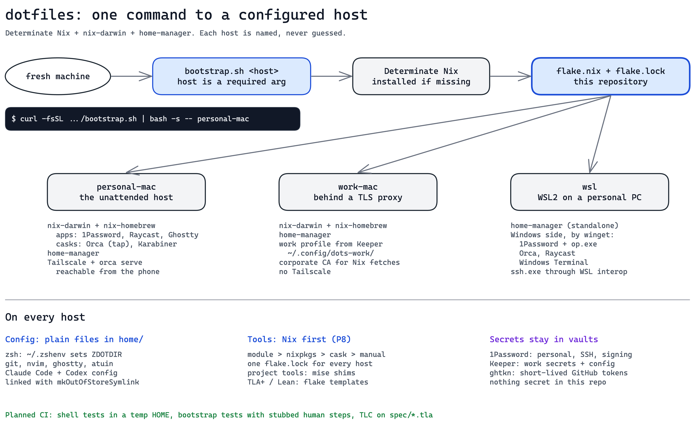

# dotfiles

Nix-based dotfiles for agent-first development on macOS and WSL2. One command turns a fresh machine into a configured host, coding agents see the same tools as an interactive shell, and secrets stay in vaults.

> **Status: design only.** Nothing is implemented yet. [`docs/design.md`](docs/design.md) is the design, [`docs/adr/`](docs/adr/) records the decisions, and [`docs/verification.md`](docs/verification.md) holds the evidence behind each factual claim. Statements marked **Unverified** there still need a real machine.



## What it sets up

| Area | Choice | Decision |
|---|---|---|
| Nix | Determinate Nix, nix-darwin on macOS, standalone home-manager on WSL2, one committed `flake.lock` | [ADR 0001](docs/adr/0001-nix-stack.md) |
| Where tools come from | Nix first: a module, then a nixpkgs package, then a Homebrew cask, then a manual install | [design: Principles](docs/design.md#principles) |
| Shell | zsh with `ZDOTDIR` under `~/.config`, PATH built in `.zshenv` so non-interactive shells and agents see the same tools | [design: Shell](docs/design.md#shell) |
| Project tools | mise in shims mode; TLA+ and Lean as flake templates | [ADR 0006](docs/adr/0006-project-layer-mise-shims.md) |
| Secrets | 1Password for personal secrets, SSH, and signing; Keeper for the work profile | [ADR 0002](docs/adr/0002-vaults-and-work-profile.md), [ADR 0005](docs/adr/0005-commit-signing.md) |
| GitHub tokens | Short-lived tokens from ghtkn; `gh` is a wrapper, never logged in | [ADR 0004](docs/adr/0004-github-auth-ghtkn.md) |
| Coding agents | Claude Code and Codex config linked from `home/`, `settings.json` generated per profile; Claude Code itself from its self-updating native installer | [ADR 0003](docs/adr/0003-agent-config-profiles.md), [ADR 0011](docs/adr/0011-claude-code-native-installer.md) |
| Agent guardrails | Sandbox, `permissions.deny`, and a few hooks built with `writeShellApplication` | [ADR 0007](docs/adr/0007-agent-guardrails.md) |
| Shell history | atuin, with tokens kept out of anything an AI reads | [ADR 0009](docs/adr/0009-shell-history-atuin.md) |
| Working away from the desk | `personal-mac` stays awake, runs `orca serve`, and is reached over Tailscale from Orca's mobile app | [ADR 0010](docs/adr/0010-unattended-host-reachability.md) |
| Repository checks | treefmt-nix, gitleaks, and `git diff --check`, run by lefthook and CI | [ADR 0008](docs/adr/0008-repo-checks-lefthook-treefmt.md) |

## Hosts

| Host | What it is |
|---|---|
| `personal-mac` | The personal Mac. Also the unattended host that agents run on while the owner is away. |
| `work-mac` | The work Mac, behind a TLS-intercepting proxy. Company configuration comes from Keeper and never enters this repository. |
| `wsl` | WSL2 on a personal Windows PC. Windows-side apps (1Password, Orca, Raycast, Windows Terminal) are installed with winget by hand. |

## Install (planned)

```bash
curl -fsSL https://raw.githubusercontent.com/paveg/dotfiles/main/scripts/bootstrap.sh | bash -s -- <host>
```

`<host>` is required and is never guessed. The script installs Nix, clones this repository with ghq, switches, and stops at each step only a person can do (signing in to 1Password, Keeper, and ghtkn). Running the same command again resumes it. See [design: Bootstrap](docs/design.md#bootstrap).

## Principles

- **Agents are first-class users.** Their configuration lives here next to the shell and editor config, and the design covers it with the same tests and review.
- **Same tools for every caller.** PATH holds real executables only, so a GUI app, a non-interactive shell, and an agent resolve the same binaries.
- **Reproducible over clever.** Locked definitions, one command, and nothing that depends on guessing the machine.
- **No secrets in the repository.** Secrets come from a vault at run time; company information stays in the work profile.
- **Checked, not asserted.** Factual claims in the docs cite their source, and TLA+ models of the bootstrap and of the programs that write `settings.json` are checked by TLC in CI, each with mutants that must fail.

The full list is in [`docs/design.md`](docs/design.md#principles).

## Layout

| Path | Contents |
|---|---|
| [`docs/design.md`](docs/design.md) | Goals, architecture, bootstrap, CI, acceptance criteria, open questions |
| [`docs/adr/`](docs/adr/) | Architecture decision records |
| [`docs/verification.md`](docs/verification.md) | Evidence for every factual statement in the design |
| [`docs/diagrams/`](docs/diagrams/) | Rendered diagrams (PNG); their Excalidraw sources are not tracked |
| [`spec/`](spec/) | TLA+ models checked with TLC; `check.sh` also confirms that each property catches a deliberately broken model |
| [`.github/workflows/`](.github/workflows/) | CI: `spec.yml` runs `spec/check.sh` |
| [`AGENTS.md`](AGENTS.md) | Rules for coding agents working in this repository |

The planned implementation layout (`flake.nix`, `nix/`, `home/`, `hosts/`, `scripts/`, `templates/`) is in [design: Repository layout](docs/design.md#repository-layout).
